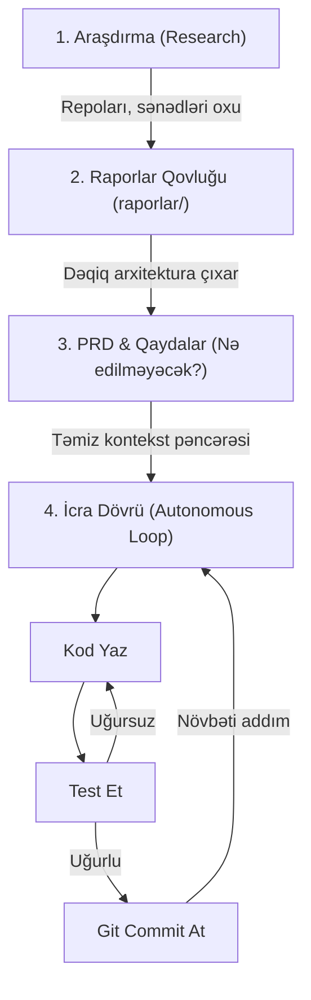

# AI Modelindən 100% Verim Almaq: Kontekst Mühəndisliyi və Otonom Sistemlər

> **Mənbə Video:** [Aynı Yapay Zekadan Neden Bu Kadar Farklı Sonuç Alıyoruz?](https://www.youtube.com/watch?v=INo2BTNzZw0)  
> **Kanal:** Avenox  
> **Əsas Fəlsəfə:** *"Fərq modeldə deyil — fərq kontekstdədir. Eyni model ilə biri sadə bir sayt qura bilmir, NASA isə Mars roverinə marşrut çəkdirir."*

---

## 🧭 BÖLÜM 1: Modelin Əsl Anatomiyası (İllüziyaları Dağıtmaq)

Süni intellektlə işləyərkən insanların 90%-nin ilişib qaldığı ən böyük səhv: **Modeli davamlı yaşayan, şüurlu bir insan kimi təsəvvür etməkdir.**

### 1. "Hər Turda Doğulan və Ölən Dahi" (Stateless Təbiət)
* Model səninlə canlı danışmır.
* Sən hər `Enter` basanda model **sıfırdan yaranır**, bütün keçmiş mesajları və verilən sənədləri bir göz qırpımında oxuyur, cavabı yazır və **dərhal ölür**.
* **Uşaq dili ilə bənzətmə:** Bir dahi təsəvvür et ki, hər 1 dəqiqədən bir yaddaşı tamamilə sıfırlanır (amneziya). O, oyananda qarşısında hansı qeyd dəftəri varsa, dünyanı yalnız ondan ibarət bilir. Dəftərdə zibil yazılıbsa — zibil cavab verir; dəftərdə dəqiq xəritə varsa — Marsa raket uçurur.

### 2. "Şüşə Balon və Qoruyucu Qəfəs" (Harness Effekti)
* **Model kod icra etmir, fayl açmır, terminalda əmr işlətmir!**
* Model şüşə balonun içindədir. Onun dünyaya yeganə çıxışı **MƏTN (Text)** yazmaqdır.
* Ətrafındakı sistem (**Harness** — Antigravity, Claude Code, Cursor və s.) modelin yazdığı mətni oxuyur:
  * Model yazır: `<run_command> git status </run_command>`
  * Harness bunu görür, kompüterdə əmri işə salır və nəticəni təkrar mətn kimi modelin balonuna atır.
* Model sadəcə bu gələn mətni oxuyaraq növbəti addımı təyin edir.

### 3. Hallüsinasiya Niyə Baş Verir?
* Model heç vaxt qəsdən yalan danışmır.
* Modelin tək bir məqsədi var: **Əlindəki mətndən sonra gələcək ən məntiqli kəlmələri düzmək.**
* Əgər sən ona dəqiq sənəd (kontekst) verməsənsə, o boşluğu öz təlim məlumatlarından ehtimallarla doldurur (yəni uydurur).
* **Qızıl Düstur:** Dəqiq kontekst = 0% hallüsinasiya.

---

## 🧩 BÖLÜM 2: Miflərin Dağıdılması (Prompt, Skill, MCP, RAG, Memory)

İnternetdə hər gün yeni bir termin çıxır: *Prompt Engineering, Skill, MCP, RAG, Long-term Memory...*  
Əslində bunların **hamısı eyni şeyin fərqli adlarıdır: YALNIZ VƏ YALNIZ KONTEKST.**

| Termin | Əslində Nədir? | Uşaq Dili ilə Sadə İzah |
| :--- | :--- | :--- |
| **Prompt** | Giriş mətni | Sənin ustanın qabağına qoyduğun cari tapşırıq kağızı. |
| **Skill** | Saxlanılmış qaydalar / skriptlər | Ustanın keçmiş təcrübələrdən çıxardığı "Qızıl reseptlər" dəftərçəsi. Lazım olanda açır, oxuyur. |
| **MCP (Model Context Protocol)** | Xarici alətlərə körpü | Modelin kənardakı bazadan və ya API-dan özünə təzə məlumat gətirmək üçün uzatdığı "mətn qolu". |
| **RAG** | Axtarış və süzgəc | Kitabxanadakı 1000 kitabdan yalnız həmin dəqiqə lazım olan 2 səhifəni kəsib modelin masasına qoymaq. |
| **Memory** | Qeyd vərəqi | Model hər dəfə ölüb-diriləndə qarşısına qoyulan "İstifadəçi Emin kimdir və nəyi sevir?" xülasəsi. |

---

## 🎯 BÖLÜM 3: Kontekst Mühəndisliyinin Qızıl Qaydaları

### Qayda 1: "Az, amma İsabətli Bəslə" (Noise vs Signal)
* **Ən böyük səhv:** 20 dənə faylı bütöv kopyalayıb modelin içinə atmaq.
* Çox məlumat verdikdə modelin diqqəti (attention) dağılır, ən vacib detal gözdən qaçır.
* **Həll:** 1 dəqiq, təmiz fayl/sxem, 10 dənə qarışıq fayldan qat-qat güclüdür.

### Qayda 2: %5 Zəhmət Qaydası
Saatlarla prompt bəzəməyə ("Sən 20 illik senior memarsan...") ehtiyac yoxdur. Sən sadəcə modelə 3 şeyi ver:
1. **Dəqiq Məqsəd:** Nəticə nə olmalıdır? (Məsələn: "FPS 60-dan aşağı düşməməlidir").
2. **Lazımi Sənəd / Nümunə:** Kodun aid olduğu ən son API sənədi və ya sxemi.
3. **Alət:** Oxuma, yazma və test etmə imkanı.

### Qayda 3: Kontekst Sıfırlaması (Context Reset)
* Model ilə uzun-uzadı müzakirə etdin, fikirləri aydınlaşdırdın.
* Həmin çirklənmiş çatda birbaşa koda keçmə!
* Modele de: *"Bütün müzakirəmizi 1 səhifəlik icra planı və PRD kimi yaz."*
* Həmin planı götür, **çatı sıfırla** (yeni təmiz pəncərə aç) və yalnız o planı verərək: *"Başla!"* de.
* Nəticə 10 dəfə daha təmiz və xətasız olacaq.

---

## ⚡ BÖLÜM 4: Gələcəyin İşi — Otonom Dövrlər (Loops) və Agent Orkestrasiyası

Əvvəllər modellər 1 dəqiqəlik işlərdən sonra səhv edirdi. İndi isə düzgün mühitdə **15-20 saatlıq insan işini təkbaşına icra edə bilirlər.**

### İdeal Otonom İş Axını:

1. **Araşdırma:** Başlamazdan əvvəl Github-dakı ən yaxşı açıq mənbəli repolara və sənədlərə baxdırıb `raporlar/` qovluğuna qeyd yığdırırsan.
2. **Qadağalar və Limitlər:** Nəyi etmək qədər, **nəyi ETMƏMƏK** lazım olduğunu açıq yazırsan.
3. **Tənbəl Prompt:** Kontekst tamdırsa, əmrin qısa ola bilər: *"Plandakı 2-ci modulu yaz, testdən keçir, commit et və 3-ə keç."*
4. **Paralel Agentlər:** Böyük tapşırığı hissələrə bölüb bir neçə köməkçiyə paylamaq.

---

## 🛠️ BÖLÜM 5: Emin Üçün Fərdi Fəaliyyət Planı (Cyber-Runner və Sistem Avtomatlaşdırması)

Bizim İkinci Beyin (Second Brain) sistemimiz məhz bu videodakı fəlsəfə ilə qurulub:
* `🔮 850-Companion/Core.md` — Sənin kim olduğunu və iş prinsiplərini hər turda modelə xatırladan **Daimi Kontekstdir**.
* `beyin.py` — Sənin keçmiş qeydlərindən lazım olanı dərhal çəkib çıxaran **RAG/Retrieval qoludur**.
* `layihe/` — Tapşırıqların və memarlıq qərarlarının saxlandığı **Raporlar bazasıdır**.

### Cyber-Runner və Oyun Proqramlaşdırmasında Necə İstifadə Edəcəyik?
1. **Oyun mexanikası qurmazdan əvvəl:** Kodu birbaşa yazdırmırıq. Əvvəlcə internetdən/oxşar layihələrdən ən optimal Godot/Unity və ya WebGPU arxitekturasını araşdırıb 1 səhifəlik `raporlar/mexanika_adi.md` faylı yaradırıq.
2. **Kontekst Təmizliyi:** Müzakirə bitdikdə həmin sənədi baza götürüb təmiz tapşırıq veririk.
3. **Avtomatlaşdırılmış Loop:** Hər yeni funksiya üçün:
   - Funksiya yazılır
   - Test və ya konsol yoxlaması aparılır
   - Uğurlu olduqda avtomatik Git commit atılır.
